<h3><code>arijeet@github ~ $ whoami</code></h3>

<table>
<tr>
<td valign="top"></td>
<td valign="top"></td>
</tr>
</table>

## About me

Hi, I'm **Arijeet** - a B.Tech Computer Science graduate (2025) building my career in **data analytics**.

- Turning raw data into dashboards and decisions with **Power BI**, **Excel** and **Python**
- Currently building hands-on projects in **SQL**, **BI** and **Python**
- Co-founded **[Leodor](https://leodor.in)**, a luxury perfumery brand - hands-on experience with sales, customers and numbers
- Looking for entry-level data analyst opportunities

## Tech and tools

**Currently learning and building with:** SQL

## Featured projects

| Project | What it is | Status |
| --- | --- | --- |
| SQL and BI project | Analysis and dashboard built on a real dataset | In progress |
| Stock price prediction | Python-based analysis and prediction model | Uploading soon |
| Chess NLP | Natural language processing on chess data | Uploading soon |

Each project will have its own repo with the problem, data, approach, results and screenshots.

## Let's connect

